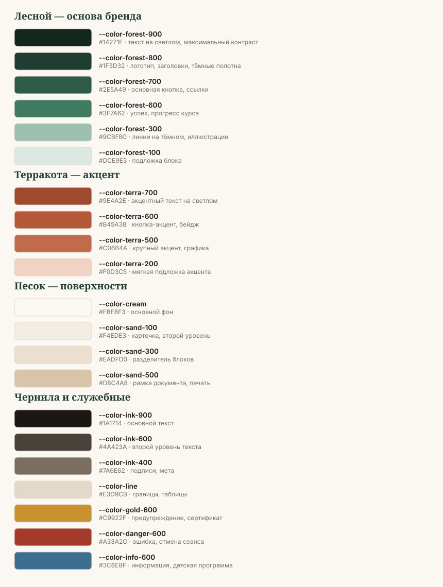

# Цвет

Направление — **тёплый премиум-спа**: глубокий лесной зелёный как основа, терракота
как единственный акцент, песочные поверхности вместо белого. Белый в системе почти
не используется: он даёт клиническую холодность, которой бренд избегает.

## Правило 60–30–10

| Доля | Роль | Цвета |
|---|---|---|
| 60 % | поверхности | `cream`, `sand-100`, `sand-300` |
| 30 % | структура и текст | `forest-800`, `forest-700`, `ink-900`, `ink-600` |
| 10 % | акцент | `terra-500`, `terra-600` |

Терракота никогда не занимает больше десятой части макета. Если акцента много —
он перестаёт быть акцентом, и макет уходит в «пиццерию».

## Полная палитра

### Лесной — основа

| Токен | HEX | Назначение |
|---|---|---|
| `--color-forest-900` | `#14271F` | тёмные полотна, текст максимального контраста |
| `--color-forest-800` | `#1F3D32` | логотип, заголовки, подвал, обложки |
| `--color-forest-700` | `#2E5A49` | основная кнопка, ссылки, активные элементы |
| `--color-forest-600` | `#3F7A62` | успех, прогресс курса, подтверждение записи |
| `--color-forest-300` | `#9CBFB0` | линии и графика на тёмном фоне |
| `--color-forest-100` | `#DCE9E3` | подложка информационного блока |

### Терракота — акцент

| Токен | HEX | Назначение |
|---|---|---|
| `--color-terra-700` | `#9E4A2E` | акцентный **текст** на светлом фоне |
| `--color-terra-600` | `#B45A38` | акцентная кнопка, бейдж, маркер |
| `--color-terra-500` | `#C06B4A` | крупная графика, дуга знака, иллюстрация |
| `--color-terra-200` | `#F0D3C5` | мягкая подложка акцентного блока |

### Песок — поверхности

| Токен | HEX | Назначение |
|---|---|---|
| `--color-cream` | `#FBF8F3` | основной фон страницы и макета |
| `--color-sand-100` | `#F4EDE3` | карточка, второй уровень поверхности |
| `--color-sand-300` | `#EADFD0` | разделение блоков, зебра таблицы |
| `--color-sand-500` | `#D8C4A8` | рамка документа, печать, декоративная линия |

### Чернила и служебные

| Токен | HEX | Назначение |
|---|---|---|
| `--color-ink-900` | `#1A1714` | основной текст |
| `--color-ink-600` | `#4A423A` | второй уровень текста, дескриптор |
| `--color-ink-400` | `#7A6E62` | подписи, мета, плейсхолдеры |
| `--color-line` | `#E3D9CB` | границы, линии таблиц |
| `--color-gold-600` | `#C9922F` | предупреждение, рамка сертификата |
| `--color-danger-600` | `#A33A2C` | ошибка, отмена сеанса, просрочка |
| `--color-info-600` | `#3C6E8F` | информация, детская программа |

## Сегментные акценты

У центра четыре типа клиента, и каждому нужен свой маркер — но внутри одной палитры,
без «разноцветных суббрендов». Акцент применяется только к бейджу, полосе слева
на карточке и иконке. Никогда — к фону всего макета.

| Сегмент | Цвет маркера | Где встречается |
|---|---|---|
| Корпоративный пакет | `forest-700` | КП, отчёт, админка |
| Частный клиент | `terra-600` | сайт, соцсети, карта курса |
| Подарочный сертификат | `gold-600` | сертификат, сезонные посты |
| Детская программа | `info-600` | карточка программы, направление врача |

## Контраст: проверенные пары

Коэффициенты посчитаны по WCAG 2.1. **AA** для обычного текста — от 4.5:1,
для крупного (от 24 px или 19 px полужирного) — от 3:1.

### На фоне `cream` (#FBF8F3)

| Цвет текста | Контраст | Вердикт |
|---|---|---|
| `ink-900` | **16.85** | AAA — основной текст |
| `forest-900` | **14.80** | AAA |
| `forest-800` | **11.19** | AAA — заголовки |
| `ink-600` | **9.30** | AAA — второй уровень |
| `forest-700` | **7.41** | AAA — ссылки |
| `danger-600` | **6.20** | AA |
| `terra-700` | **5.71** | AA — акцентный текст |
| `info-600` | **5.19** | AA |
| `forest-600` | **4.75** | AA — на пределе, не для мелкого шрифта |
| `ink-400` | **4.68** | AA — только для подписей от 14 px |
| `terra-600` | **4.44** | ✗ не для обычного текста, только крупный |
| `terra-500` | **3.64** | только крупный текст от 24 px |
| `gold-600` | **2.60** | ✗ **никогда как текст** — только заливка |

### На тёмном

| Фон | Текст | Контраст |
|---|---|---|
| `forest-800` | `cream` | **11.19** AAA |
| `forest-800` | `sand-100` | **10.20** AAA |
| `forest-800` | `forest-100` | **9.49** AAA |
| `forest-800` | `terra-200` | **8.37** AAA |
| `forest-900` | `cream` | **14.80** AAA |
| `forest-700` | `cream` | **7.41** AAA — кнопка |
| `terra-600` | `белый` | **4.71** AA — акцентная кнопка |
| `forest-600` | `белый` | **5.03** AA |

### Жёсткие запреты по контрасту

- `gold-600` как цвет текста — **нигде**. Только плашка с тёмным текстом поверх.
- `terra-500` и `terra-600` как текст мельче 24 px — нет.
- `ink-400` на `sand-300` (3.77) — нет. Только на `cream` и `sand-100`.
- `forest-300` как текст на светлом (1.89) — нет. Это цвет для линий на тёмном.
- Текст поверх фотографии без подложки — нет, независимо от цвета.

## Градиенты и прозрачность

Система почти не использует градиенты. Разрешены два:

1. **Затемнение фото** — `forest-900` от 0 % до 55 % сверху вниз или снизу вверх.
   Нужно, чтобы поставить на фото логотип или текст.
2. **Мягкое поле** — `sand-100` → `cream` под большим блоком, не более 8 % разницы.
   Используется в обложках и документах, никогда в интерфейсе.

Запрещены: радужные переходы, зелёный → терракота в одном градиенте, glassmorphism,
неоновые свечения.

## Тёмная тема веб-платформы

| Роль | Светлая | Тёмная |
|---|---|---|
| Фон | `cream` | `#101D18` |
| Поверхность | `sand-100` | `#16281F` |
| Поверхность 2 | `sand-300` | `#1F3D32` |
| Текст | `ink-900` | `#EFE7DB` |
| Текст 2 | `ink-600` | `#B3A897` |
| Граница | `line` | `#2A4035` |
| Основное действие | `forest-700` | `#4E9478` |
| Акцент | `terra-600` | `#D47B55` |

Акцент в тёмной теме **светлее**, чем в светлой: на тёмном фоне терракота `terra-600`
теряет насыщенность и уходит в бурый.

## Проверка перед сдачей

- [ ] Терракоты не больше 10 % площади.
- [ ] Весь текст прошёл контраст по таблицам выше.
- [ ] `gold-600` нигде не использован как текст.
- [ ] Белый не используется как основной фон (только `cream`).
- [ ] Макет остаётся читаемым в чёрно-белой печати — проверено обесцвечиванием.
- [ ] Смысл нигде не передаётся **только** цветом: у статуса есть ещё иконка или подпись.
