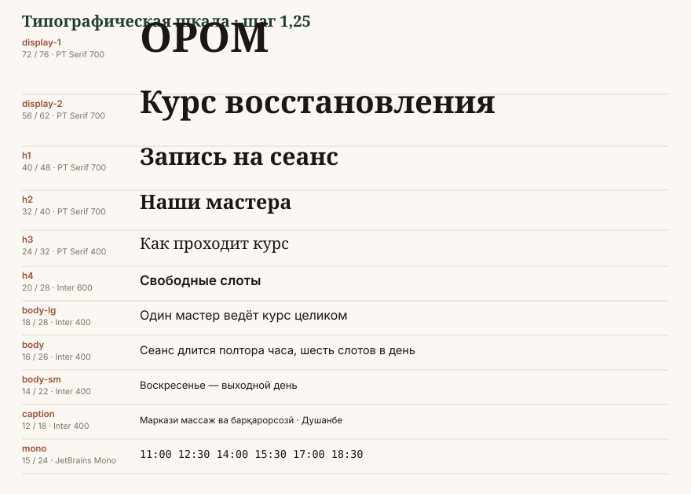

# Типографика



## Шрифты

| Роль | Шрифт | Начертания | Почему |
|---|---|---|---|
| Дисплейный | **PT Serif** | Regular 400, Bold 700 | полная поддержка таджикской кириллицы `ӣ ӯ қ ҳ ҷ ғ`, тёплые засечки, бесплатен |
| Текстовый | **Inter** | 400, 500, 600 | нейтральный гротеск, отличная читаемость в интерфейсе, большой x-height |
| Запасной текстовый | **PT Sans** | 400, 700 | когда нужны гарантированные таджикские глифы в вебе и печати |
| Моноширинный | **JetBrains Mono** | 400 | время, номера сеансов, таблицы расписания, коды |

Все четыре — открытые лицензии (SIL OFL / Apache). Можно ставить на сервер, встраивать
в PDF, передавать подрядчику без доплат.

### Критическая проверка глифов

Таджикская кириллица использует шесть букв, которых нет в русской: **ғ ӣ қ ӯ ҳ ҷ**.
Многие популярные шрифты (включая большинство дисплейных Google Fonts) их не содержат —
вместо буквы появится прямоугольник или подстановка из другого шрифта с другим рисунком.

**Перед утверждением любого шрифта наберите эту строку:**

```
Ғафурӣ Қаҳҳор ҷӯйбор ҳавз ӣ ӯ — ҒӢҚӮҲҶ
Маркази массаж ва барқарорсозӣ
```

Если хоть один знак отрисован другим шрифтом — шрифт не подходит, замены нет.

Проверенные: PT Serif ✓, PT Sans ✓, Inter ✓ (с версии 3.19), Noto Serif ✓, Noto Sans ✓.
Не подходят: Playfair Display ✗, Cormorant ✗, Montserrat (частично) ✗.

## Шкала

Шаг шкалы — 1,25 (мажорная терция). Все значения кратны 2.

| Токен | Размер / интерлиньяж | Начертание | Применение |
|---|---|---|---|
| `display-1` | 72 / 76 | PT Serif 700 | обложка постера, первый экран сайта |
| `display-2` | 56 / 62 | PT Serif 700 | заголовок сторис, титул документа |
| `h1` | 40 / 48 | PT Serif 700 | заголовок страницы |
| `h2` | 32 / 40 | PT Serif 700 | раздел |
| `h3` | 24 / 32 | PT Serif 400 | подраздел, заголовок карточки |
| `h4` | 20 / 28 | Inter 600 | заголовок блока в интерфейсе |
| `body-lg` | 18 / 28 | Inter 400 | лид, вводный абзац |
| `body` | 16 / 26 | Inter 400 | основной текст |
| `body-sm` | 14 / 22 | Inter 400 | второстепенный текст, таблицы |
| `caption` | 12 / 18 | Inter 400 | подпись, мета, сноска |
| `overline` | 12 / 16, трекинг +8 %, ВЕРХНИЙ РЕГИСТР | Inter 600 | надзаголовок, категория |
| `mono` | 15 / 24 | JetBrains Mono 400 | время сеанса, номер курса |

### Мобильная шкала

На экранах уже 600 px display-размеры уменьшаются, текст — нет:

| Токен | Десктоп | Мобильный |
|---|---|---|
| `display-1` | 72 | 40 |
| `display-2` | 56 | 32 |
| `h1` | 40 | 28 |
| `h2` | 32 | 24 |
| `h3` | 24 | 20 |
| остальные | без изменений | без изменений |

## Правила набора

### Длина строки
- Основной текст: **60–75 знаков** в строке. Шире — глаз теряет начало строки.
- Лид и цитата: 45–60 знаков.
- В двух колонках — не больше 45 знаков на колонку.

### Выключка
- Текст — **по левому краю**, всегда. Выключка по формату даёт «реки» в русском
  и таджикском из-за длинных слов.
- По центру допускается только: заголовок обложки, сертификат, короткая цитата до 3 строк.
- По правому краю — только цифры в таблицах.

### Переносы
- Автоматические переносы **включены** для русского и таджикского (`hyphens: auto`,
  `lang="ru"` / `lang="tg"`). Без них длинные слова ломают узкие колонки.
- В заголовках переносы **выключены**. Разрыв строки ставится вручную по смыслу.
- Неразрывный пробел обязателен: `10 сеансов`, `1,5 ч`, `г. Душанбе`, `11:00 — 12:30`,
  перед тире в предложении.

### Регистр
- ВЕРХНИЙ РЕГИСТР — только `overline` и название в логотипе. Заголовки капслоком
  не набираются: таджикские диакритики в верхнем регистре читаются хуже.
- Капитель не используется — в PT Serif её нет, искусственная выглядит дёшево.

### Цифры
- В таблицах и расписании — **моноширинные** (`font-variant-numeric: tabular-nums`),
  иначе колонки времени «пляшут».
- В тексте — обычные.
- Телефон в таджикском формате: `+992 93 172 77 77`, группами, с неразрывными пробелами.
- Даты: `23.10.2026` в документах, `23 октября 2026` в тексте, `2026-10-23` в технических полях.

### Типографика пунктуации
- Кавычки: русский и таджикский — «ёлочки», вложенные — „лапки“. Английский — “curly”.
- Тире — длинное `—` с пробелами. Дефис в словах — короткий.
- Диапазон — короткое тире без пробелов: `11:00–12:30`, `10–15 сеансов`.
- Запрещены: прямые кавычки `"`, двойной дефис вместо тире, три точки вместо многоточия.

## Типографические пары

| Ситуация | Заголовок | Текст |
|---|---|---|
| Сайт, лендинг | PT Serif 700 | Inter 400 |
| Интерфейс, админка | Inter 600 | Inter 400 |
| Документ, сертификат | PT Serif 700 | PT Serif 400 |
| Соцсети, постер | PT Serif 700 | Inter 500 |
| Титры в видео | Inter 600 | Inter 500 |

В интерфейсе засечки не используются в мелком кегле — на экране 14 px PT Serif теряет
читаемость. Серифы живут в заголовках и в документах.

## Иерархия: один пример

```
ВОССТАНОВЛЕНИЕ                        overline   · Inter 600, 12, трекинг +8%, terra-700
Курс из десяти сеансов                display-2  · PT Serif 700, 56/62, forest-800
за три недели                         h3         · PT Serif 400, 24/32, ink-600

Один мастер ведёт курс от первого      body-lg    · Inter 400, 18/28, ink-900
до последнего сеанса. Время
закреплено на весь курс.

11:00 · 12:30 · 14:00 · 15:30          mono       · JetBrains Mono, 15/24, ink-600
```

Правило: **не больше трёх уровней размера в одном блоке**. Четвёртый уровень делается
цветом или начертанием, но не новым кеглем.

## Запреты

1. Не более двух гарнитур в одном макете (моноширинный для цифр не считается).
2. Искусственные жирность и курсив — запрещены. Только настоящие начертания.
3. Отрицательный трекинг в основном тексте — запрещён. В display допускается до −1 %.
4. Текст поверх фото без затемняющей подложки.
5. Вертикальный и дугообразный набор.
6. Интерлиньяж меньше 1,2 кегля — в кириллице с диакритиками строки слипаются.
7. Обводка и тень у текста.
