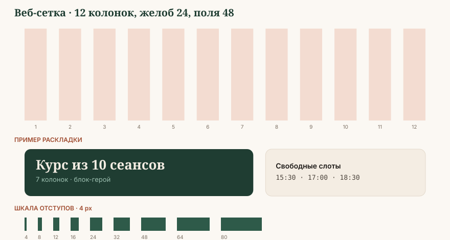

# Сетка, отступы, слои

## Базовая единица: 4 px

Всё в системе кратно четырём. Это даёт совпадение ритма между вебом, документами
и соцсетями без пересчёта.

| Токен | Значение |
|---|---|
| `--space-1` | 4 px |
| `--space-2` | 8 px |
| `--space-3` | 12 px |
| `--space-4` | 16 px |
| `--space-5` | 20 px |
| `--space-6` | 24 px |
| `--space-8` | 32 px |
| `--space-10` | 40 px |
| `--space-12` | 48 px |
| `--space-16` | 64 px |
| `--space-20` | 80 px |
| `--space-24` | 96 px |
| `--space-32` | 128 px |

### Как выбирать отступ

| Отношение элементов | Отступ |
|---|---|
| Внутри одного элемента (иконка и подпись) | `space-2` — `space-3` |
| Между элементами одной группы (поля формы) | `space-4` |
| Между группами внутри блока | `space-8` |
| Между блоками страницы | `space-16` — `space-20` |
| Между разделами страницы | `space-24` — `space-32` |

Главное правило: **расстояние внутри группы всегда меньше расстояния между группами.**
Нарушение этого — причина 90 % «каши» в макетах.

## Веб-сетка

| Брейкпойнт | Ширина | Колонки | Желоб | Поля |
|---|---|---|---|---|
| `xs` мобильный | < 600 px | 4 | 16 px | 16 px |
| `sm` планшет | 600–899 px | 8 | 20 px | 24 px |
| `md` ноутбук | 900–1279 px | 12 | 24 px | 32 px |
| `lg` десктоп | 1280–1599 px | 12 | 24 px | 48 px |
| `xl` широкий | ≥ 1600 px | 12 | 32 px | авто, контейнер 1440 px |

**Максимальная ширина контента:** 1200 px. Текстовый блок — не шире 720 px
независимо от ширины экрана.

## Сетка печатных форматов

| Формат | Размер | Поля | Колонки |
|---|---|---|---|
| A4 документ | 210 × 297 мм | 20 / 20 / 25 / 20 мм | 1 или 2 |
| A4 отчёт с таблицей | 210 × 297 мм | 15 мм по бокам | таблица во всю ширину |
| A3 постер | 297 × 420 мм | 24 мм | 3 |
| A5 сертификат | 210 × 148 мм (альбом) | 14 мм + рамка 6 мм внутрь | 1 |
| Визитка | 90 × 50 мм | 5 мм | 1 |

Вылеты под обрез — 3 мм, безопасное поле — 5 мм от края.

## Сетка соцсетей

| Формат | Пиксели | Безопасное поле | Применение |
|---|---|---|---|
| Квадрат | 1080 × 1080 | 64 px | пост в ленте |
| Вертикальный пост | 1080 × 1350 | 64 px | основной формат ленты |
| Сторис, рилс | 1080 × 1920 | 180 px сверху, 320 px снизу | сторис, рилс, Shorts |
| Обложка рилс в сетке | 1080 × 1350 | центральный квадрат 1080 × 1080 держит смысл | превью профиля |
| Горизонталь | 1920 × 1080 | 80 px | YouTube, презентация |
| Аватар | 320 × 320 | круг вписан | профиль |

Нижние 320 px в сторис закрывают интерфейс платформы и кнопка «ответить» — туда
не ставится ни текст, ни логотип.

## Радиусы

| Токен | Значение | Где |
|---|---|---|
| `--radius-sm` | 6 px | бейдж, тег, поле ввода |
| `--radius-md` | 12 px | кнопка, карточка, фото в интерфейсе |
| `--radius-lg` | 20 px | крупная карточка, модальное окно |
| `--radius-xl` | 32 px | блок-герой, большая фотография |
| `--radius-pill` | 999 px | фильтр-чип, индикатор слота |
| `--radius-none` | 0 | таблица, документ, печатная полоса |

Фотографии в вебе скругляются `radius-lg`, в документах — не скругляются вовсе.

## Тени

Тени мягкие, тёплые, почти незаметные. Тень в системе означает «этот слой выше»,
а не «красиво».

| Токен | Значение |
|---|---|
| `--shadow-xs` | `0 1px 2px rgba(26, 23, 20, .06)` |
| `--shadow-sm` | `0 2px 8px rgba(26, 23, 20, .07)` |
| `--shadow-md` | `0 8px 24px rgba(26, 23, 20, .09)` |
| `--shadow-lg` | `0 20px 48px rgba(26, 23, 20, .12)` |

Тень всегда нейтрально-тёплая (на основе `ink-900`), никогда не чёрная и не цветная.
В печати теней нет — вместо них линия `line` 1 pt.

## Слои (z-index)

| Слой | Значение | Что |
|---|---|---|
| base | 0 | контент |
| sticky | 100 | закреплённая шапка, липкая строка таблицы |
| dropdown | 200 | выпадающий список, автодополнение |
| overlay | 300 | затемнение под модальным окном |
| modal | 400 | модальное окно, панель записи |
| toast | 500 | уведомление об успехе записи |
| tooltip | 600 | подсказка |

## Композиционные правила

1. **Один герой на макет.** Один элемент крупный, остальные — тише. Два равных
   по весу объекта ломают макет.
2. **Воздух сверху и снизу не равен.** Снизу больше на 25–30 % — макет не «проваливается».
3. **Фотография прижата к краю** или оставляет полное поле. Фото с маленьким
   неравномерным отступом выглядит ошибкой вёрстки.
4. **Текст не на пёстром.** Либо плашка, либо затемнение, либо чистая область фото.
5. **Правило трёх блоков.** В постере — не больше трёх смысловых блоков:
   что, для кого, как записаться.

## Запас на длину строки в трёх языках

Таджикский текст в среднем **на 10–15 % длиннее** русского, английский — на 10–20 %
короче. Макет собирается по самому длинному варианту.

| Элемент | Запас |
|---|---|
| Кнопка | +25 % ширины или перенос на две строки |
| Заголовок | +15 % высоты блока |
| Пункт меню | фиксированная ширина по самому длинному языку |
| Подпись поля формы | +20 % |

Проверка: подставьте во все текстовые места таджикскую версию и убедитесь,
что ничего не обрезано и не наехало. Только после этого макет готов.
