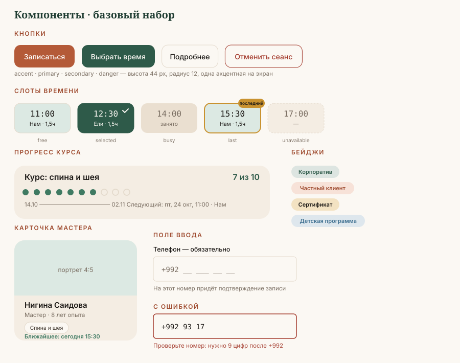

# Библиотека компонентов



Каждый компонент описан одинаково: назначение, анатомия, состояния, токены, правила.
Компонент без описанных состояний считается неготовым.

---

## 1. Button — кнопка

**Варианты**

| Вариант | Фон | Текст | Когда |
|---|---|---|---|
| `primary` | `--action-primary` | `--text-on-inverse` | основное действие экрана |
| `accent` | `--action-accent` | `#FFFFFF` | только «Записаться» |
| `secondary` | прозрачный, граница `--border-default` | `--text-primary` | второе действие |
| `ghost` | прозрачный | `--text-link` | третьестепенное, в таблицах |
| `danger` | прозрачный, граница `--status-danger` | `--status-danger` | отмена сеанса |

**Размеры**

| Размер | Высота | Паддинг | Шрифт |
|---|---|---|---|
| `sm` | 36 px | 0 `--space-4` | `--text-body-sm` 500 |
| `md` | 44 px | 0 `--space-6` | `--text-body` 500 |
| `lg` | 52 px | 0 `--space-8` | `--text-body-lg` 500 |

Минимальная область нажатия на мобильном — 44 × 44 px, даже у `sm`.

**Состояния**

| Состояние | Что меняется |
|---|---|
| `default` | базовый вид |
| `hover` | фон → `*-hover`, 80 мс |
| `active` | `translateY(1px)`, без изменения тени |
| `focus-visible` | обводка 2 px `--border-focus`, отступ 2 px |
| `disabled` | непрозрачность 45 %, курсор `not-allowed`, не фокусируется |
| `loading` | текст остаётся, слева спиннер 16 px, ширина **не меняется** |

**Правила**

- На экране **одна** акцентная кнопка. Две акцентные — ошибка приоритета.
- Текст кнопки — глагол: «Записаться», «Выбрать время», «Отправить заявку».
  Запрещено: «Отправить», «ОК», «Подробнее», «Узнать больше».
- Ширина кнопки рассчитывается по самому длинному из трёх языков: таджикский текст
  в среднем длиннее русского на 10–15 %.
- Радиус — `--radius-md`. Кнопки-таблетки используются только для фильтр-чипов.

---

## 2. SlotChip — слот времени

Ключевой компонент платформы: 6 слотов × 3 кабинета — это вся операционная модель центра.

**Анатомия**

```
┌──────────────┐
│    11:00     │   ← время, --text-mono
│   Нам · 1,5ч │   ← кабинет и длительность, --text-caption
└──────────────┘
    88 × 56 px
```

**Состояния**

| Состояние | Фон | Текст | Граница |
|---|---|---|---|
| `free` | `--slot-free` | `--text-primary` | `--border-default` |
| `selected` | `--slot-selected` | `--text-on-inverse` | `--slot-selected` + галочка |
| `busy` | `--slot-busy` | `--text-muted` | нет, не кликается |
| `unavailable` | `--slot-unavailable` | `--text-muted`, зачёркнуто | пунктир |
| `last` | `--slot-free` + бейдж | `--text-primary` | `--status-warning` 2 px |

`last` — «последний свободный слот в этот день». Показывается честно: только когда
в этом дне у этого мастера действительно остался один слот.

**Правила**

- Занятый слот **не скрывается**, а показывается серым. Клиенту важно видеть,
  что центр загружен — это социальное доказательство.
- Слот 15:30 в маркетинговых блоках может нести бейдж «Дневная цена» —
  это заполняет структурный провал в 23,5 % загрузки.
- Никогда не показываем ФИО другого клиента в занятом слоте на публичной части.

---

## 3. CourseProgress — прогресс курса

Главный компонент бренда. Делает видимым то, что центр продаёт — курс, а не сеанс.

**Анатомия**

```
Курс: спина и шея                                      7 из 10
● ● ● ● ● ● ● ○ ○ ○
14.10 ─────────────────────────────────── 02.11
Следующий сеанс: пт, 24 октября, 11:00 · Нам
```

| Элемент | Токен |
|---|---|
| Пройденная точка | `--status-success`, заливка, 10 px |
| Оставшаяся точка | `--border-default`, контур, 10 px |
| Пропущенная | `--status-danger`, контур, 10 px, крестик внутри |
| Счётчик «7 из 10» | `--text-h4` |
| Даты | `--text-caption`, `--text-muted` |
| Следующий сеанс | `--text-body-sm`, `--text-primary` |

**Состояния курса**

| Состояние | Признак |
|---|---|
| `active` | зелёные точки, видна дата следующего сеанса |
| `ending` | осталось ≤ 2 сеансов, рамка `--status-warning`, кнопка «Продлить курс» |
| `completed` | все точки залиты, блок «Пройден» и кнопка «Новый курс» |
| `paused` | точки серые, подпись «Пауза с 10.10» |
| `expiring` | срок курса истекает, но сеансы остались — `--status-danger` и срок |

**Правило:** когда остаётся 2 сеанса, компонент сам предлагает продление.
Это главный механизм удержания: сегодня у центра 0 активных частных клиентов
во второй месяц.

---

## 4. TherapistCard — карточка мастера

Появилась в системе из-за данных: загрузка кабинетов расходится от 34 % до 71,6 % —
клиенты идут к человеку, а не в центр. Значит, человека нужно показать.

**Анатомия**

```
┌─────────────────────────┐
│                         │
│      [портрет 4:5]      │
│                         │
├─────────────────────────┤
│ Нигина Саидова          │  --text-h4
│ Мастер · 8 лет опыта    │  --text-body-sm / --text-muted
│                         │
│ Спина и шея · Лимфо     │  теги, --radius-pill
│                         │
│ Ближайшее: сегодня 15:30│  --text-body-sm, --status-success
│ [Выбрать мастера]       │  Button secondary md
└─────────────────────────┘
```

Фон карточки `--bg-surface`, радиус `--radius-lg`, тень `--shadow-sm`, портрет
со скруглением сверху `--radius-lg`.

**Правила**

- Опыт указывается в годах, только если он подтверждён. Без «лучший мастер города».
- Ближайший свободный слот подтягивается из расписания в реальном времени —
  это и есть смысл карточки.
- Все карточки одной высоты независимо от длины текста.

---

## 5. Input — поле ввода

| Элемент | Токен |
|---|---|
| Высота | 48 px |
| Фон | `--bg-page` |
| Граница | 1 px `--border-default`, `--radius-sm` |
| Текст | `--text-body` |
| Подпись (label) | `--text-body-sm` 500, **над** полем, всегда видна |
| Плейсхолдер | `--text-muted`, пример формата, не дубль подписи |
| Подсказка | `--text-caption`, `--text-muted`, под полем |
| Ошибка | граница `--status-danger`, текст ошибки `--text-caption` `--status-danger` + иконка |

**Правила**

- Плавающая подпись (floating label) **не используется** — она исчезает при вводе
  и мешает аудитории старше 50.
- Поле телефона: маска `+992 __ ___ __ __`, клавиатура `tel`, автозаполнение.
- Ошибка пишется человеческим языком: «Проверьте номер: нужно 9 цифр после +992»,
  а не «Неверный формат».
- Обязательные поля помечаются словом «обязательно», а не звёздочкой.

---

## 6. BookingWidget — виджет записи

Описан отдельно: [`03-booking-pattern.md`](03-booking-pattern.md).

---

## 7. Badge — бейдж

| Вариант | Фон | Текст |
|---|---|---|
| `corporate` | `--segment-corporate` 12 % | `--segment-corporate` |
| `private` | `--segment-private` 12 % | `--text-accent` |
| `certificate` | `--segment-certificate` 15 % | `--color-ink-900` |
| `child` | `--segment-child` 12 % | `--segment-child` |
| `success` | `--status-success` 12 % | `--status-success` |
| `warning` | `--status-warning` 18 % | `--color-ink-900` |
| `danger` | `--status-danger` 10 % | `--status-danger` |

Высота 24 px, паддинг 0 `--space-3`, радиус `--radius-pill`, шрифт `--text-caption` 600.

`certificate` и `warning` — единственные бейджи с тёмным текстом: `gold-600`
не проходит контраст как цвет текста (2.60 на `cream`), поэтому работает только заливкой.

---

## 8. Card — карточка

| Уровень | Фон | Граница | Тень |
|---|---|---|---|
| `flat` | `--bg-surface` | нет | нет |
| `outlined` | `--bg-page` | 1 px `--border-default` | нет |
| `raised` | `--bg-surface` | нет | `--shadow-sm` |
| `interactive` | `--bg-surface` | нет | `--shadow-sm` → `--shadow-md` при наведении |

Паддинг: `--space-6` на десктопе, `--space-4` на мобильном. Радиус `--radius-lg`.

---

## 9. Table — таблица

Главная таблица системы — расписание и учёт клиентов.

| Элемент | Токен |
|---|---|
| Шапка | `--bg-surface-2`, `--text-overline`, липкая при прокрутке |
| Строка | высота 48 px, граница снизу 1 px `--border-default` |
| Зебра | чётные строки `--bg-surface` 50 % |
| Наведение | строка → `--bg-surface` |
| Числа | выключка вправо, `tabular-nums` |
| Первая колонка | липкая по горизонтали при прокрутке |

**На мобильном** таблица превращается в список карточек: каждая строка — карточка
с парами «подпись — значение». Горизонтальная прокрутка таблицы на телефоне запрещена.

---

## 10–24. Остальные компоненты

| Компонент | Ключевое правило |
|---|---|
| `Select` | список длиннее 7 пунктов получает поиск |
| `DatePicker` | воскресенье отображается выключенным, а не отсутствующим |
| `Stepper` | шаги подписаны словами, не только цифрами |
| `Tabs` | до 4 вкладок; больше — выпадающий список |
| `Accordion` | первый пункт раскрыт на странице FAQ |
| `Modal` | закрывается по Esc и клику вне; фокус возвращается на вызвавшую кнопку |
| `BottomSheet` | мобильная замена Modal; высота не более 85 % экрана |
| `Toast` | 4 секунды, не перекрывает кнопку, не требует закрытия вручную |
| `Alert` | иконка + заголовок + текст; цвет не единственный признак |
| `Avatar` | инициалы на `--color-forest-700`, если фото нет |
| `Breadcrumbs` | не используются на публичном сайте, только в админке |
| `Pagination` | 20 строк на страницу; всего строк показывается явно |
| `EmptyState` | иллюстрация + одна фраза + одно действие |
| `Skeleton` | повторяет геометрию контента, пульс 1600 мс |
| `LanguageSwitcher` | RU / ТҶ / EN, текущий язык выделен, не прячется в бургер |

---

## Общие требования ко всем компонентам

- [ ] Описаны все шесть состояний: default, hover, active, focus-visible, disabled, loading.
- [ ] Фокус виден с клавиатуры, порядок обхода логичен.
- [ ] Работает на трёх языках без обрезания текста.
- [ ] Область нажатия не меньше 44 × 44 px на мобильном.
- [ ] Смысл не передаётся только цветом.
- [ ] Все значения — токены, ни одного «магического» пикселя или HEX.
