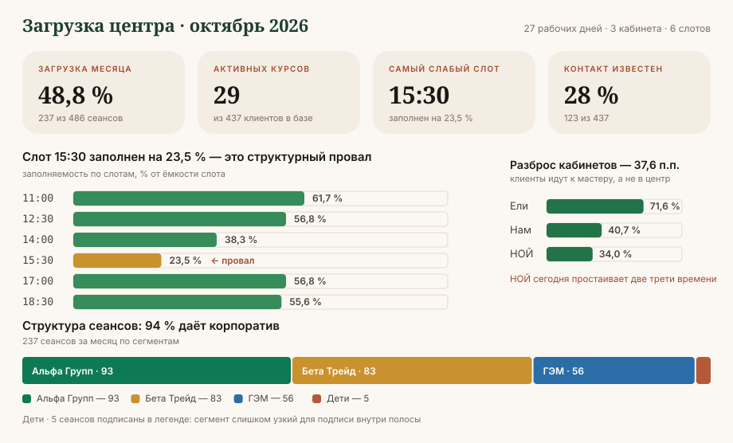

# Админ-панель и дашборд



Админ-панель заменяет текущую учётную книгу. Соответствие один к одному:

| Лист Excel | Экран платформы |
|---|---|
| «Запись на приём» | `/admin/schedule` — день: 3 кабинета × 6 слотов |
| «График на месяц» | `/admin/month` — матрица день × кабинет × слот |
| «Учёт клиентов» | `/admin/clients` — база с группами и курсами |
| сводные строки внизу листов | `/admin/reports` — дашборд и отчёты |

---

## Экран «Расписание дня» — главный

```
┌─ 23 октября, пятница ────────────── [‹ вчера] [сегодня] [завтра ›] ────────┐
│  Загрузка дня: 12 из 18 · 67 %                            [+ Записать]    │
├───────────┬──────────────────┬──────────────────┬──────────────────┬──────┤
│  Время    │  Нам             │  Ели             │  НОЙ             │      │
├───────────┼──────────────────┼──────────────────┼──────────────────┼──────┤
│  11:00    │ Бобоев С. 8/10  │ Ятимова Ш. 3/10  │ свободно         │      │
│  12:30    │ Холова М. 5/10 │ Саидова Н. 6/10│ свободно         │      │
│  14:00    │ свободно         │ Шарипова З. 9/10│ свободно         │      │
│  15:30    │ свободно         │ свободно         │ свободно         │ ⚠    │
│  17:00    │ Одинаев С. 4/10 │ Назаров Б. 7/10  │ свободно         │      │
│  18:30    │ Муродов Ч. 2/10  │ Холов А. 10/10  │ свободно         │      │
└───────────┴──────────────────┴──────────────────┴──────────────────┴──────┘
```

- В ячейке: фамилия, инициал, прогресс курса `8/10`. Полное ФИО — по наведению.
- Пустая строка целиком (как 15:30) подсвечивается `--status-warning` с подсказкой
  «весь слот свободен — отправьте рассылку».
- Кабинет без единой записи за день (как НОЙ) получает метку «простой» — это
  именно тот сигнал, которого не даёт таблица в Excel.
- Клик по ячейке — карточка клиента; клик по пустой — быстрая запись.
- Воскресенье: экран показывает «Выходной день» и не позволяет записать.

---

## Экран «Месяц»

Матрица 27 строк × 18 колонок — слишком плотная для чтения цифрами, поэтому это
**тепловая карта** по заполненности дня, с раскрытием дня в строку слотов.

- Шкала — последовательная, один тон (зелёная рампа из раздела «Графики» ниже).
- Воскресенья — штриховка, не белая дырка: отсутствие данных и выходной
  должны читаться по-разному.
- Под матрицей — строка итогов: рабочих дней, сеансов, загрузка.

---

## Экран «Клиенты»

| Колонка | Поведение |
|---|---|
| ФИО | липкая при горизонтальной прокрутке |
| Группа | бейдж сегмента (`corporate` / `private` / `certificate` / `child`) |
| Нам / Ели / НОЙ | счётчики сеансов по кабинетам, выключка вправо |
| Итого | сумма, полужирный |
| Курс | `CourseProgress` в компактном виде |
| Начало / окончание | даты курса |
| Телефон | **если пусто — подсвечено `--status-danger`** |

Фильтры одной строкой над таблицей: группа · активность · наличие телефона ·
состояние курса. Подсветка пустого телефона — не придирка: сегодня контакта
нет у 72 % базы, и это прямой блок на повторные продажи.

---

## Дашборд `/admin/reports`

### Слой 1 — числа, а не графики

Четыре KPI-плитки. Для одного числа график не рисуется.

| Плитка | Значение | Подпись |
|---|---|---|
| Загрузка месяца | **48,8 %** | 237 из 486 сеансов |
| Активных курсов | **29** | из 437 клиентов в базе |
| Самый слабый слот | **15:30** | заполнен на 23,5 % |
| Контакт известен | **28 %** | 123 из 437 |

Плитка: число `--text-display-2`, подпись `--text-caption` `--text-muted`,
цвет числа — `--text-primary`, **не** цвет статуса. Цветом статуса красится
только маленькая стрелка динамики рядом.

### Слой 2 — три графика

**1. Заполняемость по слотам** — горизонтальные полосы, один тон

Задача — величина, а не идентичность, поэтому один зелёный тон, а не четыре цвета.
Самый слабый слот подписан прямо.

```
11:00  ████████████████████████  61,7 %
12:30  ██████████████████████    56,8 %
14:00  ███████████████           38,3 %
15:30  █████████                 23,5 %  ← провал
17:00  ██████████████████████    56,8 %
18:30  █████████████████████     55,6 %
```

**2. Загрузка кабинетов** — те же полосы, одна шкала

```
Ели    ████████████████████████████  71,6 %
Нам    ████████████████              40,7 %
НОЙ    █████████████                 34,0 %
```

Разброс 37,6 п.п. выводится отдельным числом под графиком — это и есть вывод.

**3. Структура сеансов по сегментам** — одна горизонтальная полоса с долями

```
Альфа 93 │ Бета Трейд 83 │ ГЭМ 56 │ Дети 5
```

Четыре категории — здесь идентичность, значит категориальная палитра
в фиксированном порядке (ниже), с подписями на каждом сегменте.

### Запрещено на дашборде

- **Две шкалы Y в одном графике.** Загрузка в процентах и сеансы в штуках —
  это два графика, а не один с двумя осями.
- Круговые и кольцевые диаграммы для сравнения кабинетов: доли близки, углы не читаются.
- Градиентные заливки полос.
- Радужные палитры и раскраска по рангу: цвет закреплён за сущностью, а не за местом
  в сортировке. Поменялся фильтр — выжившие серии не перекрашиваются.
- Цвет как единственный признак: у каждой серии есть подпись.

---

## Палитра графиков

Отдельная от интерфейсной: цвета интерфейса намеренно приглушены и в графиках
читаются как серые. Значения ниже проверены на цветовую слепоту и контраст.

### Категориальная — строго в этом порядке

| № | Светлая тема | Тёмная тема | Сегмент |
|---|---|---|---|
| 1 | `#0E7A55` | `#298954` | корпоративный пакет |
| 2 | `#C9922F` | `#B18D2A` | сертификат |
| 3 | `#2A6DA8` | `#488ACB` | детская программа |
| 4 | `#B45A38` | `#BB6543` | частный клиент |

Порядок **не меняется и не циклится**. Пятая категория не придумывается —
она сворачивается в «Прочее» или выносится в отдельный график.

Проверка (OKLab ΔE, светлая тема): худшая соседняя пара `#C9922F` ↔ `#0E7A55` —
14,6 при протанопии, 25,3 при тританопии; минимум при нормальном зрении — 23,9.
Все четыре в полосе светлоты L 0,43–0,77 и выше порога цветности.

**Обязательная страховка:** `#C9922F` даёт контраст 2,6:1 к фону `--color-cream` —
ниже 3:1. Поэтому там, где он используется, обязательны видимые подписи значений
либо доступная таблица с теми же данными. Это не рекомендация, а условие применения.

### Последовательная — для тепловой карты и величин

Один тон, от светлого к тёмному, пять ступеней:

`#7DB992` → `#59A375` → `#378C5B` → `#227347` → `#195936`

Светлый конец даёт 2,15:1 к фону — карта не сливается с бумагой.
Монотонность по светлоте проверена: градации различимы и в чёрно-белой печати.

### Статусные — зарезервированы

`--status-success` · `--status-warning` · `--status-danger` · `--status-info`.
Никогда не используются как «пятая серия» и всегда идут с иконкой и подписью.

---

## Правила отрисовки графиков

| Параметр | Значение |
|---|---|
| Толщина линии | 2 px |
| Маркер точки | ≥ 8 px |
| Торец полосы | скругление 4 px со стороны значения |
| Зазор между заливками | 2 px цветом поверхности |
| Сетка | `--border-default`, только по оси значений, 1 px |
| Ось | без линии оси; подписи `--text-muted`, `--text-caption` |
| Подписи значений | выборочно: максимум, минимум, последнее. Не на каждой точке |
| Легенда | при двух и более сериях — обязательна; при одной — не нужна, серию называет заголовок |
| Текст | всегда токены текста, **никогда** цвет серии |
| Наведение | тултип обязателен; зона наведения больше самого элемента |
| Фильтры | одной строкой над графиками, не сбоку |

## Доступность дашборда

- У каждого графика есть переключатель «Таблица» с теми же данными.
- Заголовок графика содержит вывод, а не тему: «Слот 15:30 заполнен на 23,5 %»,
  а не «Заполняемость по слотам».
- Тёмная тема — отдельно подобранные ступени, а не автоматическая инверсия светлых.
- Для печати и режима высокой контрастности доступна штриховка вместо цвета.
