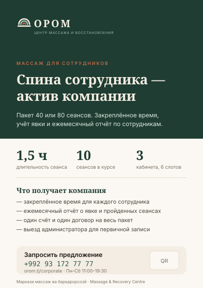

# Образцы постеров

## Постер 1 — Корпоративная программа, A3



**Где висит:** лифтовые холлы бизнес-центров, партнёрские офисы, фитнес-клубы.
**Задача:** заявка на пакет от HR или руководителя.

### Раскладка

| Зона | Высота | Содержание | Токены |
|---|---|---|---|
| Тёмное поле | 48 % | логотип, надзаголовок, заголовок, лид | фон `--bg-inverse`, текст `--text-on-inverse` |
| Три факта | 12 % | 1,5 ч · 10 · 3 | числа `--text-h2` PT Serif 700 `--color-forest-800`, подписи `--text-caption` |
| Разделитель | — | линия 1 px | `--border-default` |
| Выгоды | 22 % | четыре пункта с тире | `--text-body-sm` `--text-secondary` |
| Призыв | 14 % | плашка, телефон, сайт, QR | фон `--bg-surface`, телефон `--text-mono` `--action-primary` |
| Подпись | 4 % | дескриптор на тадж. и англ. | `--text-caption` `--text-muted` |

Поля — 24 мм со всех сторон. Вылеты 3 мм. QR ведёт на `/corporate/request`
с меткой источника `utm_source=poster_bc`.

### Текст

| Язык | Надзаголовок | Заголовок | Лид |
|---|---|---|---|
| RU | МАССАЖ ДЛЯ СОТРУДНИКОВ | Спина сотрудника — актив компании | Пакет 40 или 80 сеансов. Закреплённое время, учёт явки и ежемесячный отчёт по сотрудникам. |
| TJ | МАССАЖ БАРОИ КОРМАНДОН | Пушти корманд — сармояи ширкат | Баста аз 40 ё 80 сеанс. Вақти мустаҳкам, бақайдгирии ҳозирӣ ва ҳисоботи моҳона оид ба кормандон. |
| EN | MASSAGE FOR EMPLOYEES | Your team's back is a company asset | Packages of 40 or 80 sessions. Fixed time slots, attendance tracking and a monthly report per employee. |

---

## Постер 2 — Курс для частного клиента, A3

**Где висит:** подъезды жилых домов рядом с центром, аптеки-партнёры, спортзалы.

```
┌────────────────────────────────────────┐  фон cream
│                                        │
│   [фотография: руки мастера, 60 %]     │  прижата к верху и краям
│                                        │
├────────────────────────────────────────┤
│  ВОССТАНОВЛЕНИЕ                        │  overline, terra-700
│                                        │
│  Курс из десяти сеансов                │  display-1 → 56 pt в печати
│  за три недели                         │
│                                        │
│  ───────                               │  линия terra-500
│                                        │
│  Один мастер ведёт курс от первого     │  body-lg, ink-600
│  до последнего сеанса. Время           │
│  закреплено на весь курс.              │
│                                        │
│  11:00 · 12:30 · 14:00 · 15:30         │  mono, ink-600
│  17:00 · 18:30 · Пн–Сб                 │
│                                        │
│  [знак]  +992 93 172 77 77   [QR]      │
│          Душанбе, orom.tj              │
└────────────────────────────────────────┘
```

| Язык | Заголовок | Лид |
|---|---|---|
| RU | Курс из десяти сеансов за три недели | Один мастер ведёт курс от первого до последнего сеанса. Время закреплено на весь курс. |
| TJ | Курси даҳсеансӣ дар се ҳафта | Як устод курсро аз сеанси аввал то охирин мебарад. Вақт барои тамоми курс мустаҳкам карда мешавад. |
| EN | A ten-session course over three weeks | One therapist leads the course from first session to last. Your slot is fixed for the whole course. |

---

## Постер 3 — Дневное время, A4

**Задача:** закрыть структурный провал слота 15:30 (заполнен на 23,5 %).
**Где висит:** внутри центра, у стойки администратора, в партнёрских кафе.

```
┌──────────────────────────────┐  фон sand-100
│  ДНЕВНОЕ ВРЕМЯ               │  overline
│                              │
│  15:30                       │  display-1, mono, forest-800
│                              │
│  Самое тихое время в центре  │  h2, PT Serif
│                              │
│  Меньше людей, больше        │  body
│  внимания, то же время       │
│  сеанса — полтора часа.      │
│                              │
│  Свободно почти каждый день  │  body, terra-700
│                              │
│  [QR]  Записаться            │
└──────────────────────────────┘
```

| Язык | Заголовок | Текст |
|---|---|---|
| RU | Самое тихое время в центре | Меньше людей, больше внимания, то же время сеанса — полтора часа. |
| TJ | Оромтарин вақт дар марказ | Одам камтар, таваҷҷуҳ бештар, вақти сеанс ҳамон — як соату ним. |
| EN | The quietest hour we have | Fewer people, more attention, the same ninety minutes. |

**Важно:** на постере не указывается скидка. Дневное время продаётся спокойствием,
а не ценой — иначе центр обесценивает остальные слоты.

---

## Постер 4 — Подарочный сертификат, A4, сезонный

**Когда:** за 10–14 дней до Навруза, 8 Марта, Иди Рамазон, Иди Қурбон, Нового года.

```
┌──────────────────────────────┐  фон: градиент cream → sand-300
│  ПОДАРОК                     │  overline, terra-700
│                              │
│  Сертификат на курс          │  display-2, по центру
│                              │
│  ┌────────────────────────┐  │  изображение сертификата
│  │  рамка sand-500 2pt    │  │  с рамкой gold-600
│  │  СЕРТИФИКАТ            │  │
│  │  на курс из 10 сеансов │  │
│  │  действует 6 месяцев   │  │
│  └────────────────────────┘  │
│                              │
│  Получатель сам выбирает     │  body, по центру
│  мастера и время             │
│                              │
│  [Оформить]                  │  кнопка primary
└──────────────────────────────┘
```

| Язык | Заголовок | Подпись |
|---|---|---|
| RU | Сертификат на курс | Получатель сам выбирает мастера и время. Действует 6 месяцев. |
| TJ | Сертификат барои курс | Гиранда худаш устод ва вақтро интихоб мекунад. 6 моҳ эътибор дорад. |
| EN | A gift certificate for a course | The recipient picks their own therapist and time. Valid for six months. |

---

## Постер 5 — Мастера центра, A3

**Задача:** выровнять загрузку кабинетов (сегодня от 34 % до 71,6 %).
**Где висит:** внутри центра, в коридоре перед кабинетами.

Три портрета 4:5 в ряд, под каждым: имя, стаж, специализация, свободное время.
Портреты одинакового кадрирования и света — иначе выглядит как подборка
из разных источников.

---

## Постер 6 — Детская программа, A4

**Где:** детские поликлиники-партнёры, школы, центры развития — **только
по согласованию с учреждением.**

| Правило | Пояснение |
|---|---|
| Без фотографий детей | ни лиц, ни фигур, ни силуэтов |
| Визуал | кабинет, свет, сложенное бельё, руки мастера |
| Обязательная строка | «По направлению врача» |
| Тон | обращён к родителю, не к ребёнку |
| Шрифт | тот же, что везде. «Детских» шрифтов нет |
| Цвет-маркер | `--segment-child` `#3C6E8F` только в бейдже |

| Язык | Заголовок | Подпись |
|---|---|---|
| RU | Детский массаж по направлению врача | Мягкая работа, удобное время после школы, тот же курс из десяти сеансов. |
| TJ | Массажи кӯдакона бо роҳхати табиб | Кори мулоим, вақти мувофиқ пас аз мактаб, ҳамон курси даҳсеансӣ. |
| EN | Children's massage by medical referral | Gentle work, after-school slots, the same ten-session course. |

---

## Чек-лист постера перед печатью

- [ ] Поля 24 мм (A3) или 20 мм (A4), вылеты 3 мм.
- [ ] Разрешение изображений 300 dpi в итоговом размере.
- [ ] Цветовой профиль CMYK, чёрный текст — 100 % K, не составной.
- [ ] Телефон и QR проверены на реальном устройстве с расстояния 1,5 м.
- [ ] Заголовок читается с 3 метров.
- [ ] Нет обещаний лечения и нет срочности.
- [ ] Логотип в охранном поле, минимальный размер соблюдён.
- [ ] Дескриптор на таджикском присутствует.
- [ ] Текст вычитан носителем языка — на всех использованных языках.
