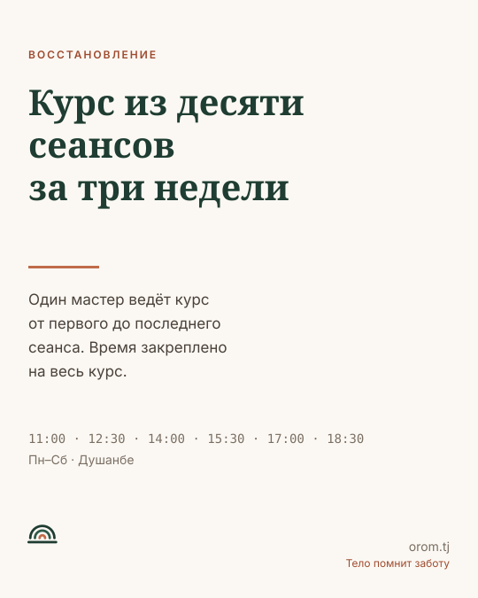
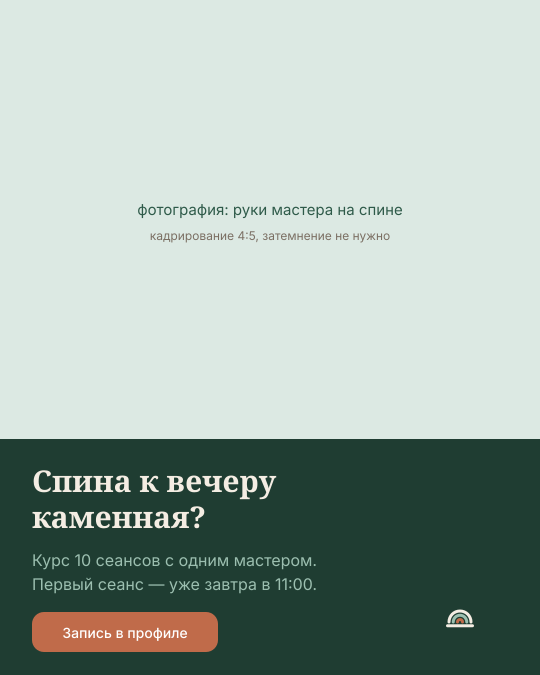
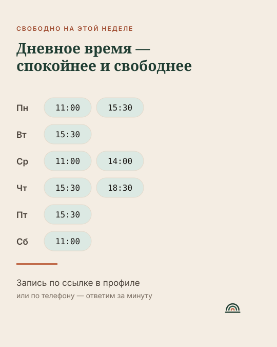

# Образцы постов

Девять готовых публикаций. Каждая — с раскладкой, токенами и текстом на трёх
языках. Подставляйте свои даты и слоты, тон и структуру не меняйте.

---

## Пост 1 — Позиционирование · схема A



**Формат:** 1080 × 1350 · **Цель:** объяснить, что центр продаёт курс.

| Элемент | Токен |
|---|---|
| Фон | `--color-cream` |
| Надзаголовок | `--text-overline`, `--text-accent` |
| Заголовок | `--text-display-2`, `--color-forest-800` |
| Линия | `--color-terra-500`, 80 × 3 px |
| Текст | `--text-body-lg`, `--text-secondary` |
| Слоты | `--text-mono`, `--text-muted` |

**Описание под постом**

> **RU.** Курс — это не десять отдельных массажей. Это одна работа, разложенная
> на три недели, с одним мастером и одним закреплённым временем.
> К десятому сеансу вы и мастер знаете про вашу спину всё.
> Записаться — ссылка в профиле.
>
> **TJ.** Курс — ин даҳ массажи ҷудогона нест. Ин як кори ягона аст, ки ба се ҳафта
> тақсим шудааст: як устод ва як вақти мустаҳкам. То сеанси даҳум шумо ва устод
> дар бораи пушти шумо ҳама чизро медонед. Барои сабти ном — истиноди профил.

---

## Пост 2 — Боль в спине · схема B



**Цель:** привлечь частного клиента с конкретной проблемой.

| Элемент | Значение |
|---|---|
| Фото | 65 % высоты, руки мастера на спине, прижато к верху и краям |
| Плашка | 35 % высоты, `--bg-inverse` |
| Заголовок | `--text-h2`, `--color-sand-100` |
| Подзаголовок | `--text-body`, `--color-forest-300` |
| Кнопка | `--color-terra-500`, текст белый |

**Текст на макете**

| Язык | Заголовок | Подзаголовок |
|---|---|---|
| RU | Спина к вечеру каменная? | Курс 10 сеансов с одним мастером. Первый — уже завтра в 11:00. |
| TJ | Бегоҳӣ пуштатон санг барин мешавад? | Курси 10-сеансӣ бо як устод. Сеанси аввал — фардо соати 11:00. |
| EN | Is your back stone by evening? | A ten-session course with one therapist. First session tomorrow at 11:00. |

**Описание**

> **RU.** Восемь часов за столом — и к вечеру шея не поворачивается.
> Один сеанс снимет напряжение на пару дней. Курс меняет то, как спина
> держит нагрузку. Разница — в системности, а не в силе рук.
> Свободно завтра: 11:00, 15:30. Запись в профиле.

---

## Пост 3 — Свободные слоты · схема C



**Цель:** продать конкретные пустые слоты. **Публикуется:** понедельник и четверг.

| Элемент | Токен |
|---|---|
| Фон | `--color-sand-100` |
| Чип слота | `--slot-free`, `--radius-pill`, граница `--border-default` |
| Время | `--text-mono` 16 px, `--text-primary` |
| День недели | `--text-body-lg` 600, `--text-secondary` |

**Правило честности:** в посте публикуются только реально свободные слоты.
Выдуманная «свободная среда» разрушает доверие быстрее, чем пустой слот —
выручку. Данные берутся из расписания в день публикации.

**Описание**

> **RU.** Свободное время на этой неделе. Сеанс — полтора часа, курс — десять
> сеансов. Если удобно дневное время, пишите: в 15:30 почти всегда есть место
> и в центре тише всего.
>
> **TJ.** Вақтҳои холӣ дар ин ҳафта. Сеанс — як соату ним, курс — даҳ сеанс.
> Агар вақти рӯзона мувофиқ бошад, нависед: соати 15:30 қариб ҳамеша ҷой ҳаст
> ва дар марказ оромтарин вақт аст.

---

## Пост 4 — Дневное время 15:30

**Цель:** закрыть провал слота 15:30 (23,5 % против 61,7 % утром).
**Аудитория:** родители, фрилансеры, сменный график, самозанятые.

```
┌──────────────────────┐  фон cream
│  15:30               │  display-1, mono, forest-800
│                      │
│  Самое тихое время   │  display-2, PT Serif
│  в центре            │
│                      │
│  ─────────           │
│                      │
│  Меньше людей.       │  body-lg
│  Больше внимания.    │
│  Те же полтора часа. │
│                      │
│  Свободно почти      │  body, terra-700
│  каждый день         │
└──────────────────────┘
```

**Описание**

> **RU.** Утро и вечер у нас расписаны. А 15:30 почти всегда свободно —
> и это лучшее время, если вы можете прийти днём. Тише, спокойнее, без очереди
> в раздевалке. Сеанс тот же: полтора часа, тот же мастер, тот же курс.
>
> **TJ.** Субҳ ва бегоҳ дар мо банд аст. Аммо соати 15:30 қариб ҳамеша холӣ —
> ва ин беҳтарин вақт аст, агар шумо рӯзона омада тавонед. Оромтар, осудатар.
> Сеанс ҳамон: як соату ним, ҳамон устод, ҳамон курс.

---

## Пост 5 — Карточка мастера

**Цель:** выровнять загрузку кабинетов. **Формат:** 1080 × 1350, портрет 4:5.

```
┌──────────────────────┐
│   портрет мастера    │  70 % высоты, 4:5, свет из окна
│                      │
├──────────────────────┤
│  Нигина Саидова      │  h2
│  Мастер · 8 лет      │  body-sm, ink-400
│                      │
│  Спина и шея ·       │  теги pill
│  Лимфодренаж         │
│                      │
│  Ближайшее: 15:30    │  body, status-success
└──────────────────────┘
```

**Описание**

> **RU.** Нигина ведёт курсы по спине и шее восемь лет. На курсе она работает
> с вами от первого до последнего сеанса — поэтому к середине курса уже знает,
> где у вас «заводится» напряжение, без объяснений.
> Ближайшее свободное время — сегодня в 15:30.

Формулировки вроде «лучший мастер», «золотые руки», «маг» — не используются.
Говорим фактами: стаж, специализация, что делает на курсе.

---

## Пост 6 — Как проходит первый сеанс · карусель 5 кадров

| Кадр | Заголовок | Текст |
|---|---|---|
| 1 | Как проходит первый сеанс | — (только заголовок на cream, крупно) |
| 2 | Разговор, 10 минут | Что беспокоит, чем занимаетесь, что было раньше. Без этого курс не строится. |
| 3 | Работа, 70 минут | Мастер идёт от зажатых зон к свободным. Больно быть не должно — скажите сразу. |
| 4 | Покой, 10 минут | Встаёте медленно. Вода. Иногда — лёгкая тяжесть в теле, это нормально. |
| 5 | Дальше — курс | Девять сеансов в то же время с тем же мастером. [Записаться] |

Все кадры в одной раскладке: номер шага `--text-overline`, заголовок
`--text-h2`, текст `--text-body`. Фон чередуется `cream` → `sand-100`.

---

## Пост 7 — Корпоративный

**Площадки:** Telegram, Facebook, LinkedIn. **Аудитория:** HR, руководитель.
**Визуал:** тёмный, `--bg-inverse`, цифры крупно, фото не обязательно.

```
┌──────────────────────┐  фон forest-800
│  КОМПАНИЯМ           │  overline, terra-500
│                      │
│  40 или 80           │  display-1, cream
│  сеансов             │
│                      │
│  закреплённое время  │  body-lg, forest-300
│  учёт явки           │
│  отчёт каждый месяц  │
│  один счёт           │
│                      │
│  [Запросить КП]      │
└──────────────────────┘
```

**Описание**

> **RU.** Корпоративный пакет — это не «абонемент для сотрудников».
> Это закреплённое время у конкретного мастера, учёт явки и отчёт в конце месяца:
> кто сколько сеансов прошёл и сколько осталось в пакете. Один договор, один счёт.
> Пакеты на 40 и 80 сеансов. Запросить предложение — в описании профиля.
>
> **EN.** A corporate package is not a staff gym card. It is a fixed slot with a
> named therapist, attendance tracking, and a monthly report: who attended, how many
> sessions remain in the package. One contract, one invoice.

---

## Пост 8 — Сертификат, сезонный

**Когда:** Навруз, 8 Марта, Иди Рамазон, Иди Қурбон, Новый год, дни рождения.

**Описание**

> **RU.** Подарок, который не нужно угадывать по размеру. Сертификат на курс
> из десяти сеансов: получатель сам выбирает мастера и время, действует полгода.
> Оформляем за пять минут — печатный бланк или файл на телефон.
>
> **TJ.** Тӯҳфае, ки андозаашро тахмин кардан лозим нест. Сертификат барои курси
> даҳсеансӣ: гиранда худаш устод ва вақтро интихоб мекунад, шаш моҳ эътибор дорад.
> Дар панҷ дақиқа омода мекунем — бланки чопӣ ё файл дар телефон.

---

## Пост 9 — Противопоказания

**Цель:** доверие через честность. Такой пост редко ставят — и зря.

```
┌──────────────────────┐  фон sand-100
│  ЧЕСТНО              │  overline
│                      │
│  Когда массаж        │  display-2
│  делать не нужно     │
│                      │
│  — температура       │  body-lg, список
│  — обострение        │
│  — свежая травма     │
│  — некоторые         │
│    состояния: нужен  │
│    совет врача       │
│                      │
│  Спросите — скажем   │  body, terra-700
│  прямо               │
└──────────────────────┘
```

**Описание**

> **RU.** Массаж помогает не всегда и не всем. При температуре, в обострении,
> на свежей травме курс начинать нельзя, а при ряде состояний нужно сначала
> спросить врача. Если сомневаетесь — напишите, что беспокоит. Если это не к нам,
> мы так и скажем.

Здесь нельзя: перечислять диагнозы, давать медицинские советы, обещать
безопасность «в любом случае». Формулировка остаётся общей и отправляет к врачу.

---

## Чек-лист поста

- [ ] Одна мысль, одно действие.
- [ ] Текст проверен на всех языках публикации носителем.
- [ ] Слоты и даты — настоящие, сверены с расписанием сегодня.
- [ ] Нет медицинских обещаний и нет срочности.
- [ ] Фото людей — с письменным согласием; детей — нет.
- [ ] Контраст текста на фото проверен.
- [ ] Безопасные поля соблюдены.
- [ ] Сгенерированное изображение помечено в тексте.
- [ ] Хештегов 5–8, в отдельном абзаце.
