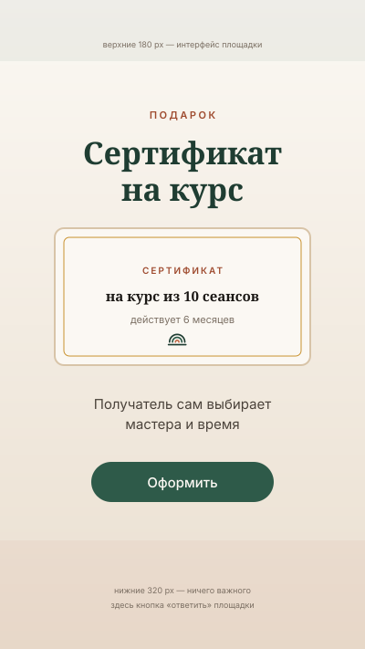

# Образцы сторис и рилс



## Общие правила вертикали 1080 × 1920

| Зона | Высота | Что можно |
|---|---|---|
| Верх | 0–180 px | ничего: интерфейс площадки, аватар, таймер |
| Рабочая зона | 180–1600 px | весь смысл |
| Низ | 1600–1920 px | ничего: кнопка «ответить», подписи платформы |

Логотип в сторис — внизу рабочей зоны, знак без слова, размер 64 px.

---

## Сторис 1 — «Свободно сегодня»

Ежедневная, публикуется в 9:30 утра.

```
          ОРОМ · сегодня          ← overline, ink-400
┌─────────────────────────────┐
│  фото кабинета с готовым    │  верхние 55 % рабочей зоны
│  столом, свет из окна       │
├─────────────────────────────┤
│  Свободно сегодня           │  h1, cream на затемнении
│                             │
│   11:00     15:30           │  чипы slot-free, mono
│                             │
│  Напишите — закрепим за вами│  body
└─────────────────────────────┘
          [знак]
```

Интерактив: стикер «Вопрос» с подписью «Какое время удобно?» — ответы падают
в директ и становятся записями. Это самый дешёвый канал записи у центра.

---

## Сторис 2 — Сертификат

Макет выше. Сезонная, 10–14 дней до праздника, 1 кадр в день.
Стикер-ссылка на `/certificate/buy`.

---

## Сторис 3 — «Один вопрос» (серия)

Формат: один вопрос — один кадр — один ответ в 2–3 строки.

| Вопрос | Ответ |
|---|---|
| Сколько длится сеанс? | Полтора часа. Из них около 70 минут — работа. |
| Можно один раз, без курса? | Можно. Но результат одного сеанса держится 2–3 дня. |
| Нужна ли справка от врача? | Для детской программы — да. Для взрослых — только при хронических состояниях. |
| Что надеть? | Ничего специального. Всё нужное выдаём на месте. |
| Больно? | Не должно быть. Скажите сразу — мастер меняет силу. |
| Почему 15:30 свободно? | Это середина рабочего дня. Если можете прийти днём — лучшее время. |

Раскладка одинакова во всех кадрах: вопрос `--text-h2` на `cream`,
ответ `--text-body-lg` `--text-secondary`, внизу знак и `orom.tj`.

---

## Рилс 1 — «Руки» (20 секунд)

Главный рилс центра. Снимается один раз, работает месяцами.

| Тайминг | Кадр | Звук | Титр |
|---|---|---|---|
| 0,0–1,5 | руки мастера на спине, макро, статика | только естественный звук | нет |
| 1,5–4,0 | тот же кадр, медленный отъезд | звук + музыка входит | «Шея к вечеру каменная?» |
| 4,0–8,0 | кабинет, свет из окна, мастер готовит стол | музыка | «Сеанс — 1,5 часа» |
| 8,0–13,0 | работа, три плана по 1,7 с | музыка | «Курс — 10 сеансов» |
| 13,0–17,0 | клиент встаёт, спокойное лицо, одевается | музыка тише | «Один мастер ведёт курс целиком» |
| 17,0–19,0 | стойка администратора, запись в журнал | музыка | «Запись по ссылке в профиле» |
| 19,0–20,5 | логотип на cream | затухание | — |

Параметры грейда, титров и звука — [`01-foundations/08-video-and-grading.md`](../01-foundations/08-video-and-grading.md).

**Запрещено:** трендовый трек с вокалом, резкие переходы, ускорение, текст поверх
лица клиента, съёмка клиента без согласия.

---

## Рилс 2 — «Один день центра» (30 секунд)

Таймлапс и короткие планы: 11:00 первый клиент → смена белья → 15:30 тихий
кабинет → 18:30 последний сеанс → свет выключается.

Титры-метки времени моноширинным шрифтом в углу: `11:00`, `15:30`, `18:30`.
Финальный титр: «Шесть сеансов в день. Три кабинета. Воскресенье — выходной».

Цель — показать ритм и занятость: это и социальное доказательство,
и честная демонстрация, что свободное время бывает.

---

## Рилс 3 — «Что происходит на первом сеансе» (35 секунд)

Разворачивает карусель из поста 6 в видео. Структура та же: разговор → работа →
покой → курс. Говорит администратор или мастер, в кадре, на русском,
субтитры на таджикском отдельной версией ролика.

---

## Рилс 4 — Корпоративный (25 секунд)

Без лиц сотрудников. Планы: офис → человек разминает шею у монитора → переход
в кабинет → руки мастера → отчёт на столе. Титры с цифрами пакета.
Финал: «40 или 80 сеансов. Отчёт каждый месяц».

Публикуется в Telegram и Facebook, не в TikTok.

---

## Чек-лист вертикального видео

- [ ] Первые 1,5 секунды — главный кадр, без логотипа и титров.
- [ ] Ничего важного в верхних 180 и нижних 320 px.
- [ ] Субтитры есть и проверены — 85 % смотрят без звука.
- [ ] Звук −14 LUFS, пики ниже −1 dBTP.
- [ ] Ролик понятен при выключенном звуке.
- [ ] Логотип в конце, не дольше 2 секунд, без анимации вылета.
- [ ] Грейд одинаков во всех планах.
- [ ] Один призыв к действию, в конце и в описании.
- [ ] Согласия на съёмку подписаны.
