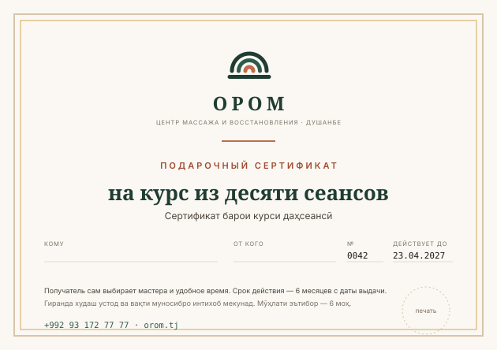

# Образец: подарочный сертификат



**Формат:** A5 альбомный, 210 × 148 мм · **Бумага:** плотная, 250–300 г/м², некрашеная
фактура · **Печать:** цифровая, при тираже от 100 — офсет в 2 краски + золото.

## Раскладка

```
┌─────────────────────────────────────────────────┐  рамка sand-500, 2 pt
│ ┌─────────────────────────────────────────────┐ │  внутренняя gold-600, 0,8 pt
│ │               [знак 18 мм]                  │ │
│ │                  ОРОМ                       │ │  PT Serif 700, трекинг +5
│ │   ЦЕНТР МАССАЖА И ВОССТАНОВЛЕНИЯ · ДУШАНБЕ  │ │  7,5 pt, ink-400
│ │                 ──────                      │ │  линия terra-500
│ │          ПОДАРОЧНЫЙ СЕРТИФИКАТ              │ │  overline, terra-700
│ │                                             │ │
│ │       на курс из десяти сеансов             │ │  PT Serif 700, 26 pt
│ │     Сертификат барои курси даҳсеансӣ        │ │  12 pt, ink-600
│ │                                             │ │
│ │  КОМУ ________  ОТ КОГО ______  № 0042      │ │  линии для рукописного
│ │                        ДЕЙСТВУЕТ ДО 23.04.27│ │
│ │                                             │ │
│ │  Получатель сам выбирает мастера и время.   │ │  9 pt
│ │  Срок действия — 6 месяцев с даты выдачи.   │ │
│ │  +992 93 172 77 77 · orom.tj      (печать)  │ │
│ └─────────────────────────────────────────────┘ │
└─────────────────────────────────────────────────┘
```

| Элемент | Токен |
|---|---|
| Фон | `--color-cream` |
| Внешняя рамка | `--color-sand-500`, 2 pt, отступ 6 мм от края |
| Внутренняя рамка | `--color-gold-600`, 0,8 pt, отступ 9 мм |
| Название | PT Serif 700, 24 pt, `--color-forest-800`, трекинг +5 |
| Надзаголовок | `--text-overline`, `--color-terra-700` |
| Номинал | PT Serif 700, 26 pt, `--color-forest-800` |
| Таджикская строка | Inter 12 pt, `--text-secondary` |
| Поля для заполнения | линия 1 pt `--color-line`, подпись 7,5 pt `--text-muted` |
| Телефон | JetBrains Mono 10,5 pt, `--color-forest-700` |

Золото здесь — тонкая рамка, а не заливка: `gold-600` даёт контраст 2,6:1
к фону и как текст не используется.

## Номиналы

| Номинал | Что внутри | Срок |
|---|---|---|
| Курс 10 сеансов | полный курс, один мастер, закреплённое время | 6 месяцев |
| Курс 5 сеансов | половина курса | 6 месяцев |
| Свободная сумма | засчитывается в счёт любого курса | 6 месяцев |

## Текст

| Язык | Надзаголовок | Номинал | Условие |
|---|---|---|---|
| RU | ПОДАРОЧНЫЙ СЕРТИФИКАТ | на курс из десяти сеансов | Получатель сам выбирает мастера и удобное время. Срок действия — 6 месяцев с даты выдачи. |
| TJ | СЕРТИФИКАТИ ТӮҲФАВӢ | барои курси даҳсеансӣ | Гиранда худаш устод ва вақти муносибро интихоб мекунад. Мӯҳлати эътибор — 6 моҳ аз рӯзи додан. |
| EN | GIFT CERTIFICATE | for a ten-session course | The recipient chooses their own therapist and time. Valid for six months from the date of issue. |

## Оборотная сторона

```
Как воспользоваться

1. Позвоните или напишите: +992 93 172 77 77
2. Назовите номер сертификата
3. Выберите мастера и время
4. Принесите сертификат на первый сеанс

Сертификат не обменивается на деньги.
Можно передать другому человеку.
При утере — восстанавливается по номеру.

[знак]                                  orom.tj
```

## Электронная версия

PDF 210 × 148 мм, ориентация альбомная, та же раскладка, но:

- номер сертификата **впечатан**, не от руки;
- добавлен QR на страницу записи с предзаполненным номером;
- поля «кому» и «от кого» заполняются при оформлении;
- в имени файла — номер: `OROM_sertifikat_0042.pdf`.

## Чек-лист

- [ ] Номер уникален и занесён в учёт.
- [ ] Срок действия проставлен и соответствует 6 месяцам от даты выдачи.
- [ ] Телефон и QR проверены.
- [ ] Таджикская строка присутствует и вычитана.
- [ ] Рамка не обрезана: вылеты 3 мм, безопасное поле 5 мм.
- [ ] Нет слова «скидка» и нет срока «акция до».
- [ ] На обороте есть инструкция и правило передачи.
