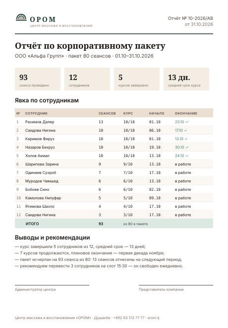

# Образец: месячный отчёт по корпоративному пакету



Главный документ центра. Он — то, за что на самом деле платит компания:
не за массаж, а за управляемость. Отправляется в первый рабочий день месяца.

**Формат:** PDF A4, 1–2 страницы. Данные в образце — реальные, из учёта центра
за октябрь 2026, по группе «Альфа Групп».

## Структура

### 1. Шапка
Логотип, номер отчёта `10-2026/АВ`, дата. Линия 1,5 pt `--color-forest-800`.

### 2. Название и реквизиты

```
Отчёт по корпоративному пакету
ООО «Альфа Групп» · пакет 80 сеансов · 01.10–31.10.2026
```

### 3. Четыре плитки сводки

| Значение | Подпись |
|---|---|
| **93** | сеанса проведено |
| **12** | сотрудников |
| **5** | курсов завершено |
| **13 дн.** | средний срок курса |

Плитка: фон `--color-sand-100`, число PT Serif 700 15 pt, подпись 6,6 pt
`--text-muted`. Цвет числа — обычный текст, не статусный.

### 4. Таблица явки

| Колонка | Выравнивание | Шрифт |
|---|---|---|
| № | влево | mono, `--text-muted` |
| Сотрудник | влево | Inter |
| Сеансов | влево | mono |
| Курс | влево | mono, формат `9/10` |
| Начало | влево | mono, `ДД.ММ` |
| Окончание | влево | mono; завершённый — `--status-success` + галочка, идущий — «в работе» |

Шапка таблицы `--color-sand-300`, зебра `--color-cream`, итоговая строка
`--color-forest-100`. Вертикальных линий нет.

Галочка рядом с датой окончания обязательна: статус не передаётся только цветом.

### 5. Итоговая строка

```
ИТОГО          93     из 80 в пакете
```

Если пакет перебран — это **показывается честно**, с пояснением в выводах.
Скрытый перерасход всплывёт при сверке и будет стоить дороже доверия.

### 6. Выводы и рекомендации

Три-четыре строки, каждая начинается с тире. Пример из образца:

```
— курс завершили 5 сотрудников из 12, средний срок — 13 дней;
— 7 курсов продолжаются, плановое окончание — первая декада ноября;
— пакет исчерпан на 93 сеанса из 80: 13 сеансов отнесены на следующий период;
— рекомендуем перевести 3 сотрудников на слот 15:30 — он свободен ежедневно.
```

Это главная ценность отчёта. Таблица показывает факт, выводы показывают,
что центр думает за клиента. Рекомендация о слоте 15:30 одновременно решает
задачу центра — его заполняемость 23,5 % против 61,7 % у утреннего.

### 7. Подписи и подвал

Две линии для подписей — администратор центра и представитель компании.
Подвал в одну строку 7,2 pt.

## Вторая страница (при необходимости)

- График явки по неделям — **один** график, горизонтальные полосы, один тон
  из последовательной рампы.
- Распределение по мастерам — таблица, не круговая диаграмма.
- Список сотрудников, не начавших курс, — отдельным блоком с пометкой
  «ожидают записи».

Правила графиков — [`03-web-platform/05-admin-dashboard.md`](../03-web-platform/05-admin-dashboard.md).
Две шкалы Y в одном графике запрещены: сеансы в штуках и загрузка в процентах —
это два разных графика.

## Что в отчёт не попадает

- Медицинская информация о сотруднике: жалобы, зоны работы, диагнозы.
  Работодатель получает только явку и объём.
- Комментарии мастера о клиенте.
- Причина пропуска сеанса.
- Персональные контакты сотрудников.

Это не формальность: отчёт передаётся третьему лицу, и всё лишнее в нём —
нарушение доверия клиента к центру.

## Автоматизация

Отчёт собирается из админ-панели за один клик: `/admin/reports` → пакет → период →
«Сформировать PDF». Ручная сборка в таблице — источник ошибок и повод для спора
с клиентом по цифрам.

## Чек-лист

- [ ] Период и номер отчёта соответствуют месяцу.
- [ ] Сумма по таблице совпадает с итоговой строкой — проверено пересчётом.
- [ ] Остаток пакета сверен с договором.
- [ ] Нет медицинской информации и личных комментариев.
- [ ] Статусы имеют подпись или значок, а не только цвет.
- [ ] Выводы содержат хотя бы одну конкретную рекомендацию.
- [ ] PDF со встроенными шрифтами, имя `OROM_otchet_<клиент>_ГГГГ-ММ.pdf`.
